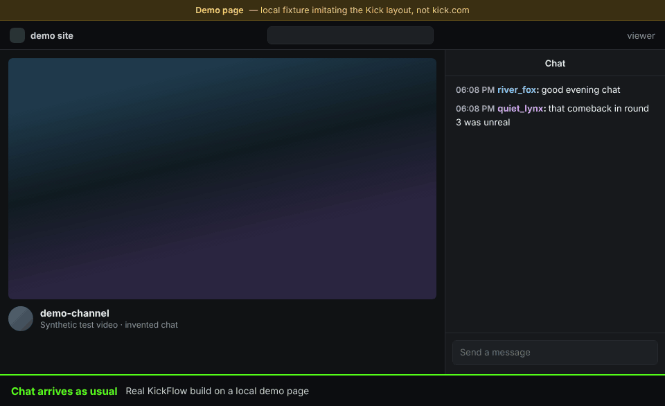
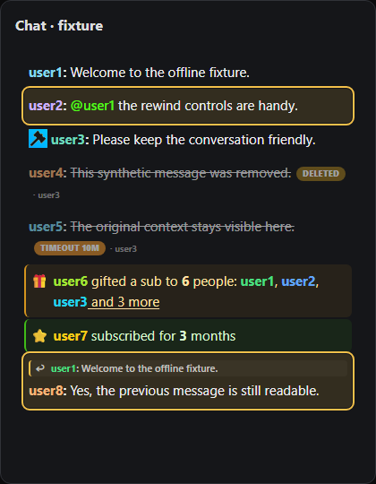
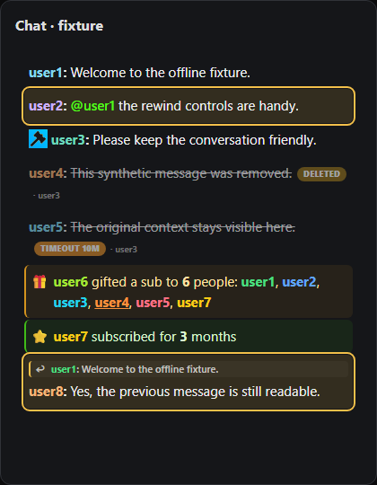
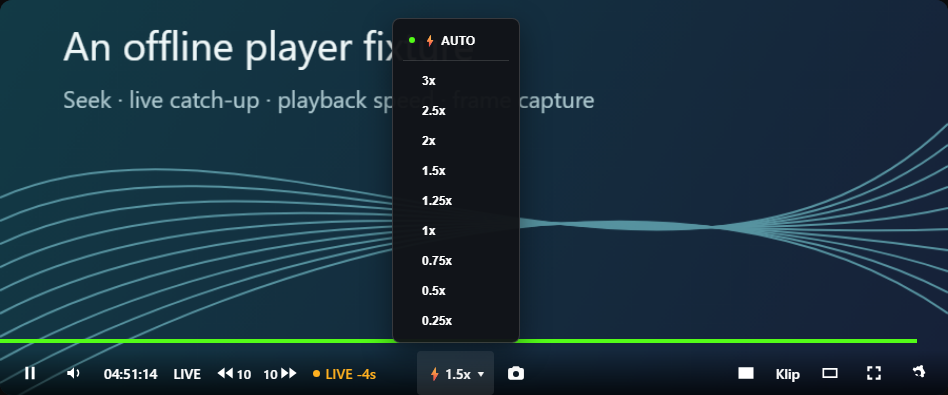
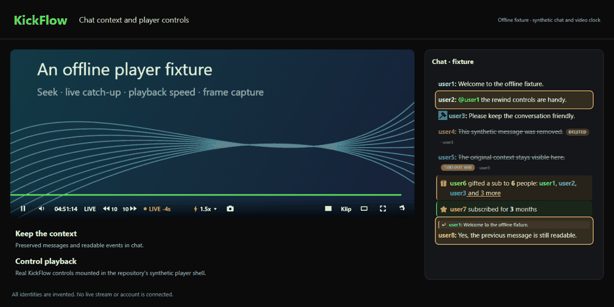
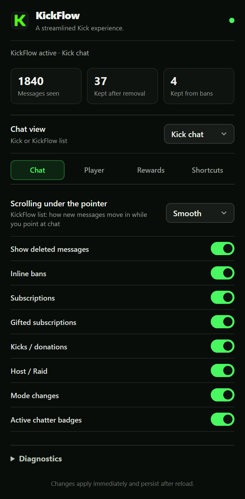
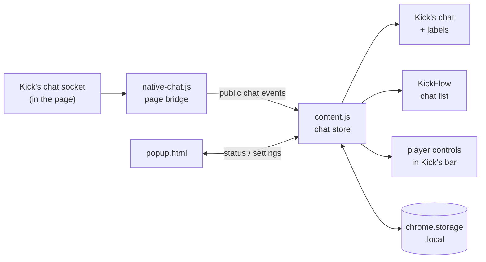

<!-- showcase:hero:start (generated from docs/showcase/showcase.yml) -->
<p align="center"></p>
<h1 align="center">KickFlow</h1>
<p align="center">
  <strong>Kick chat that keeps its context.</strong><br>
  A Chrome extension that keeps deleted and timed-out messages readable, makes channel events easy to follow, and adds rewind, speed and capture controls to the Kick player.
</p>
<p align="center">
  <a href="LICENSE"></a>
  
  <a href="https://github.com/ydbilgin/kickflow/releases/latest"></a>
</p>
<p align="center"></p>
<p align="center"><sub>Real extension build running in Chromium against a local demo page that imitates the Kick layout (not kick.com). Names, messages and video are invented; the caption strip was added afterwards.</sub></p>
<p align="center">
  <a href="#what-it-does"><b>What it does</b></a> ·
  <a href="#install"><b>Install</b></a> ·
  <a href="#use"><b>Use</b></a> ·
  <a href="#privacy-and-permissions"><b>Privacy</b></a> ·
  <a href="#how-it-works"><b>How it works</b></a> ·
  <a href="#build-from-source"><b>Build</b></a> ·
  <a href="#türkçe"><b>Türkçe</b></a>
</p>
<!-- showcase:hero:end -->

> **Unofficial, personal-use project.** KickFlow is not affiliated with, endorsed by or supported by Kick.
> It reads and extends the Kick web page in your own browser, and a change on Kick's side can break a feature
> until KickFlow is updated.

On Kick, when a moderator deletes a message or times someone out, the text disappears and the replies around it
stop making sense. The player also has no quick way to jump back a few seconds and then return to live.
KickFlow fixes both inside the page you already have open. English and Turkish interface.

## What it does

<!-- showcase:features:start (generated from docs/showcase/showcase.yml) -->
| Feature | What it does |
| --- | --- |
| **Deleted messages stay** | Messages KickFlow already received stay readable after a deletion: struck through and labelled *deleted*, with the moderator when Kick sends the name. |
| **Bans and timeouts** | A banned or timed-out user&#x27;s messages stay in place with a *banned* or *timeout 10m* style label, and a short moderator-action row says who did it. |
| **Two chat views** | Use Kick&#x27;s own chat with these additions, or switch to KickFlow&#x27;s own chat list (as in the recording). |
| **Readable events** | Subscriptions, gifted subs with an expandable list of recipients, Kicks gifts, hosts, raids and chat-mode changes as clear rows. Pins and polls stay with Kick. |
| **Find and highlight** | Search this session&#x27;s chat (Ctrl+F on the page), list one person&#x27;s messages, follow a reply back to its message. Mentions, replies, moderators and VIPs can be highlighted in your own colours. |
| **Player controls** | Back and forward 10 seconds (within the stream&#x27;s buffer), back to live, automatic catch-up, playback speed, and the highest available quality. |
| **Frame and clip capture** | Save the current frame as a PNG, or record the next 15 seconds of the picture as a local WebM clip with a preview before you save it. |
| **Shortcuts** | `Left` / `Right` seek, `L` goes live, `S` saves a frame, `Shift+S` records a clip. Each can be changed or turned off, and they do nothing while you type. |
| **Optional extras** | Theater mode on open, a guard that keeps Kick&#x27;s auto-captions from switching on by themselves, and two reward switches that click Kick&#x27;s own claim buttons. Theater mode and both reward clicks are off by default. |
<!-- showcase:features:end -->

<details>
<summary><strong>More pictures</strong> (component renders from offline test pages)</summary>

<!-- showcase:gallery:start (generated from docs/showcase/showcase.yml) -->
<table>
<tr>
<td width="50%" valign="top"><br><sub>Preserved deletions, a timeout, mention and reply highlights</sub></td>
<td width="50%" valign="top"><br><sub>Gifted-subscription row with its recipients expanded</sub></td>
</tr>
<tr>
<td width="50%" valign="top"><br><sub>The playback-speed menu in the player bar</sub></td>
<td width="50%" valign="top"><br><sub>Gift list, rewind button and speed menu</sub></td>
</tr>
</table>
<!-- showcase:gallery:end -->

These come from offline test pages that use KickFlow's real chat renderer, player controls and styles with
made-up names and messages. They show how the parts look, not that the live site is unchanged.
See [docs/media/README.md](docs/media/README.md) for how each picture was made.
</details>

## Install

KickFlow is not on the Chrome Web Store; you load it as an unpacked extension.

1. Download `KickFlow-vX.Y.Z.zip` from the [latest release](https://github.com/ydbilgin/kickflow/releases/latest)
   and extract it. (Or clone this repository: the built files in `dist/` are committed.)
2. Open `chrome://extensions` and turn on **Developer mode** (top right).
3. Click **Load unpacked** and choose the folder that holds `manifest.json`, `popup.html` and `dist/`.
4. Open any Kick channel. KickFlow is active right away.

**Updating:** replace the files, click **Reload** on the KickFlow card in `chrome://extensions`, and refresh open
Kick tabs. Chrome-based browsers that support Manifest V3 unpacked extensions should work the same way; Chrome is
the one it is tested in.

## Use

Click the KickFlow icon in the toolbar on a Kick tab:

<p align="center">
  <br>
  <sub>The real <code>popup.html</code> rendered with made-up session numbers.</sub>
</p>

- **Top:** whether KickFlow is active and which chat view is in use, then three numbers for this session:
  messages seen, kept after removal, and kept from bans.
- **Chat view:** Kick's own chat with KickFlow's additions, or the KickFlow list.
- **Tabs:** **Chat**, **Player**, **Rewards** and **Shortcuts** hold every switch. **Diagnostics** (closed by
  default) shows technical counters if something looks wrong.

Changes apply at once and survive a reload. The settings panel inside the Kick page has the same switches plus
the language (English or Turkish), highlight colours and the session search.

<details>
<summary><strong>Troubleshooting</strong></summary>

**Nothing changes on the page.** Refresh the Kick tab after installing or reloading the extension, and check
that KickFlow is on in `chrome://extensions`. The popup's top line says whether it is active on the current tab.

**A removed message did not stay.** KickFlow can only keep messages it saw arrive. Messages from before you
opened the tab, or that never reached your browser, cannot be brought back. Check that **Show deleted messages**
and **Inline bans** are on.

**Rewind does nothing or stops early.** Rewind works inside the stream's buffer; right after joining there is
little to go back to.

**A shortcut types into chat instead.** On purpose: shortcuts are ignored while a text field has focus. Click
the player first.

**Something broke after Kick changed its site.** Open **Diagnostics** in the popup and include what it shows in
an [issue](https://github.com/ydbilgin/kickflow/issues).
</details>

## Privacy and permissions

| Access | Why |
| --- | --- |
| `storage` | Your settings, language, shortcuts, highlight colours, an optional manual username and the catch-up preference, saved locally. |
| `activeTab` | Lets the popup talk to KickFlow on the tab you are looking at, for status and settings. |
| Content scripts on `https://kick.com/*` | Read and extend Kick's chat and player. Two small scripts run in the page itself to see Kick's own chat events; the main script runs in the extension's separate space. |

No background worker, no optional permissions and no other sites. KickFlow has no analytics, ads or server of its own.

- **Chat stays in memory** for the channel session only: at most 30,000 messages, three hours, and 500 messages
  per person (search shows up to 100 results). It is not a chat backup.
- **Settings** stay in `chrome.storage.local`. The caption guard changes Kick's own caption setting in the site's
  local storage, and a layout watchdog can keep a small local record (page address, time, layout sizes) there.
- **Saved frames and clips** go to your browser's download folder, only when you save them.
- **Network:** your browser loads Kick's own channel, profile, chat-history and video data and chat images, as on
  any Kick page. These requests go to Kick, from your browser.

Removing the extension clears its own storage; Kick's site data is cleared through Chrome's site-data settings.
More limits: labels are local context, not official moderation records (the page-event bridge cannot be
authenticated against other scripts on the page); quality selection cannot unlock locked options; frame capture
can fail if the browser blocks reading the video; the sidebar stays Kick's own.

## How it works



A small script in the page watches the chat socket Kick already opens and forwards only public chat events
(messages, deletions, bans, subscriptions, gifts) to the content script. The content script keeps the session's
messages in memory, so when a deletion or ban arrives it can mark the message instead of losing it, either on
Kick's own rows or in its own list. Player controls are mounted into Kick's native control bar.

## Build from source

Needs Node.js and npm.

```sh
npm ci
npm run typecheck   # tsc --noEmit
npx vitest run      # unit tests
npm run build       # writes dist/
```

Then reload the extension in `chrome://extensions` and refresh the Kick tab. The source is TypeScript in `src/`,
tests are in `tests/`, and [TESTING.md](TESTING.md) explains which check answers which question, including the
live probes under `tests/playwright/`. The README recording is reproducible with
`node docs/demo/fixture/capture.mjs` (see the header of that file).

## Contributing, security, license

- [CONTRIBUTING.md](CONTRIBUTING.md): how to build, test and propose a change.
- [SECURITY.md](SECURITY.md): report a vulnerability privately.
- [MIT License](LICENSE). Copyright (c) 2026 Yasin Derya Bilgin. Dependencies keep their own licences.

---

## Türkçe

KickFlow, Kick sohbetinde silinen ve zaman aşımı alan mesajları okunur tutan, kanal olaylarını anlaşılır
satırlarda gösteren ve oynatıcıya geri sarma, hız ve kayıt düğmeleri ekleyen ücretsiz bir Chrome eklentisidir.
**Resmî değildir; Kick ile bağlantısı yoktur.** Arayüz Türkçe ve İngilizcedir.

- **Ne yapar:** silinen mesajlar üstü çizili ve *silindi* etiketiyle, banlanan veya susturulan kullanıcının
  mesajları etiketle yerinde kalır. Oynatıcıya 10 sn geri/ileri, canlıya dönüş, hız, en yüksek kalite, PNG kare
  ve 15 sn yerel klip kaydı ekler. Kısayollar: `Sol`/`Sağ`, `L`, `S`, `Shift+S`.
- **Kurulum:** [son sürümden](https://github.com/ydbilgin/kickflow/releases/latest) ZIP dosyasını indirip çıkarın,
  `chrome://extensions` sayfasında **Geliştirici modu**nu açın ve **Paketlenmemiş öğe yükle** ile klasörü seçin.
- **Gizlilik:** analiz veya sunucu yoktur; sohbet yalnızca oturum boyunca bellekte tutulur. Ayrıntılar ve
  isteğe bağlı yardımcı eklentiye giden kısa tanılama kodları için [Privacy and permissions](#privacy-and-permissions).
- Ayrıntılar: [What it does](#what-it-does) · [Use](#use) · [Build from source](#build-from-source)
