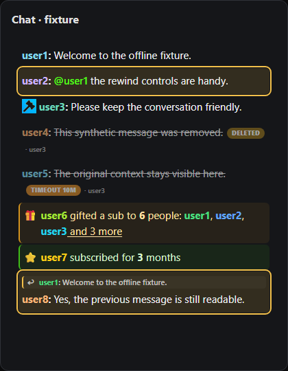
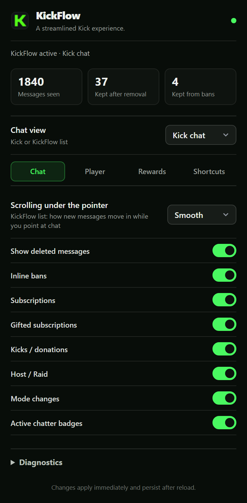
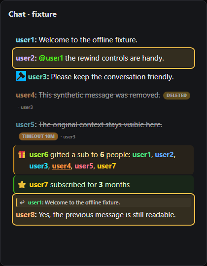
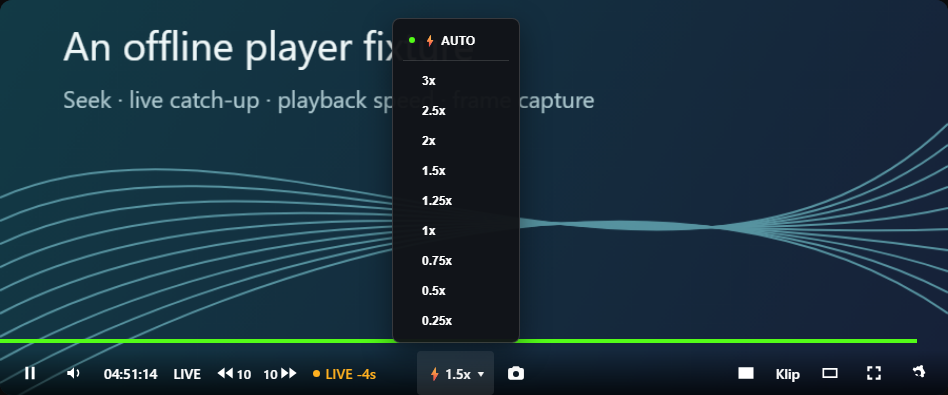
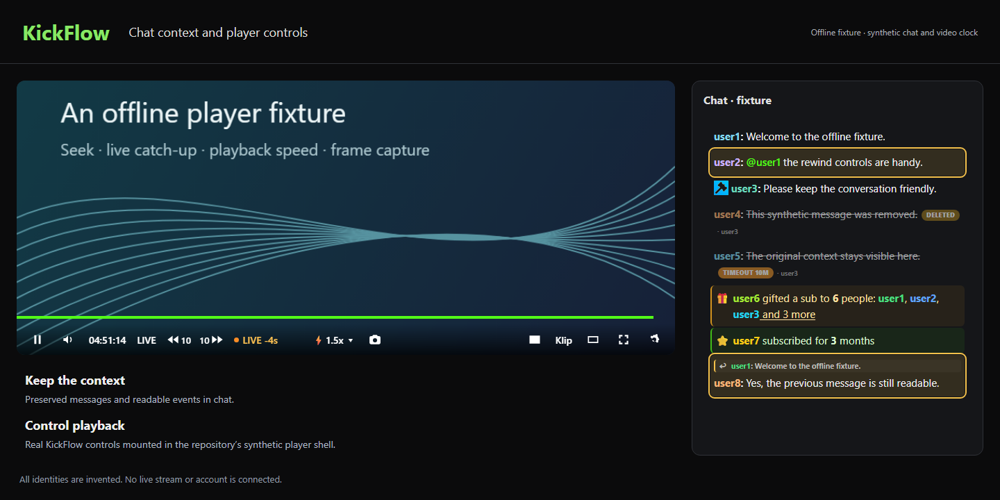
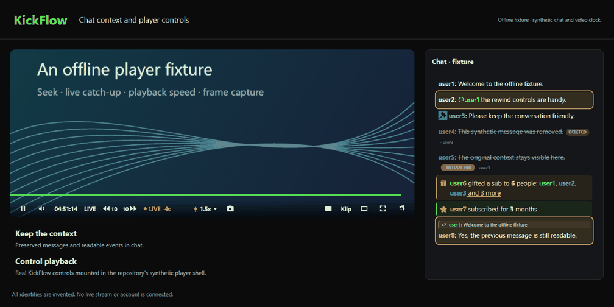

# KickFlow

**Keep Kick chat readable and get real playback controls, in Chrome.**

KickFlow is a free Chrome extension for [Kick](https://kick.com). It keeps deleted and moderated messages
readable with a label, makes chat events easy to read, and adds rewind, return-to-live, speed, quality and frame
capture buttons to the player. English and Turkish. [Türkçe özet aşağıda.](#türkçe)


## The problem

On Kick, when a moderator deletes a message or times someone out, the text disappears and the replies around it
stop making sense. And the player has no quick way to jump back a few seconds to catch what you just missed,
then return to live.

## What it does

- **Chat context:** messages you already saw stay readable after a deletion, ban or timeout, struck through and
  labelled (for example `DELETED` or `TIMEOUT 10M`, with the moderator when that is known). Use Kick's own chat
  view with these additions, or KickFlow's own chat list.
- **Readable events:** subscriptions, gifted subs with an expandable list of recipients, Kicks gifts, hosts,
  raids and chat-mode changes. Pins and polls stay with Kick.
- **Finding messages:** search this session's chat, see one person's messages, and follow a reply back to its
  message. Mentions, replies, moderators and VIPs can each be highlighted.
- **Player:** back and forward 10 seconds (as far as the stream's buffer allows), back to live, automatic
  catch-up, playback speed, the highest available quality, and save the current frame as a PNG. Optional
  theater mode and a caption-preference guard.
- **Shortcuts:** `Left` and `Right` seek, `L` goes live, `S` saves a frame; change them in the popup. They
  do nothing while you type in chat or any text field.
- **Optional reward clicks:** two switches that click Kick's own claim buttons for eligible rewards on the
  page. Both are off by default, and a click does not prove the reward was credited.



## Install

KickFlow is not on the Chrome Web Store. The built files are in this repository, so you can load it directly:

1. [Download this repository as a ZIP](https://github.com/ydbilgin/kickflow/archive/refs/heads/main.zip) and
   extract it, or `git clone https://github.com/ydbilgin/kickflow.git`.
2. Open `chrome://extensions` and turn on **Developer mode** (top right).
3. Click **Load unpacked** and choose the folder that holds `manifest.json`, `popup.html` and `dist/`.
4. Open any Kick channel. KickFlow is active right away.

**Updating:** replace the files with the new ones, click **Reload** on the KickFlow card in
`chrome://extensions`, and refresh open Kick tabs.

**Building it yourself** (Node.js and npm):

```sh
npm ci
node node_modules/typescript/bin/tsc --noEmit
node node_modules/vitest/vitest.mjs run
node build.mjs
```

Then reload the extension and refresh the channel tab.

## Using it

Click the KickFlow icon in the toolbar on a Kick tab to open the popup:

<p align="center">
  
</p>

- **Top:** whether KickFlow is active and which chat view is in use, then three numbers for this session:
  messages seen, messages kept after removal, and messages kept from bans.
- **Chat view:** Kick's own chat with KickFlow's additions, or the KickFlow list.
- **Tabs:** **Chat** (deleted messages, inline bans, event types, scrolling under the pointer), **Player**
  (rewind, catch-up, quality, frame capture, speed, theater mode), **Rewards** (the two optional claim clicks)
  and **Shortcuts** (turn each key on or off and change it). Use the arrow keys to move between tabs.
- **Diagnostics** (closed by default) shows technical counters if something looks wrong.

Every change applies immediately and is kept after a reload. The settings panel inside the Kick page has the
same switches plus the language (English or Turkish), highlight colours and the session search.

<details>
<summary><strong>More pictures</strong></summary>









These pictures come from offline test pages that use KickFlow's real chat renderer, player controls and
styles, with made-up names and messages. They show how the parts look, not that the live site is unchanged.
</details>

## Questions and troubleshooting

**Nothing changes on the page.**
Refresh the Kick tab after installing or reloading the extension. Check that KickFlow is turned on in
`chrome://extensions`. The popup's top line says whether it is active on the current tab.

**A removed message did not stay.**
KickFlow can only keep messages it saw arrive. Messages from before you opened the tab, or that never reached
your browser, cannot be brought back. Check that **Show deleted messages** and **Inline bans** are on.

**Rewind does nothing or stops early.**
Rewind works inside the stream's buffer. Right after joining, or on some streams, there is little to go back to.

**A shortcut types into chat instead.**
That is on purpose: shortcuts are ignored while a text field has focus. Click on the player first.

**Something broke after Kick changed its site.**
Kick changes its page from time to time, and that can break features until KickFlow is updated. Open
**Diagnostics** in the popup and include what it shows when you report the problem in
[Issues](https://github.com/ydbilgin/kickflow/issues).

## Permissions

| Access | Why |
| --- | --- |
| `storage` | Save your settings, language, shortcuts, highlight colours, an optional manual username and the catch-up preference, locally. |
| `activeTab` | Let the popup talk to KickFlow on the tab you are looking at, for status and settings. |
| Content scripts on `https://kick.com/*` | Read and extend Kick's chat and player. Two small scripts run in the page itself to see Kick's own chat events; the main script runs in the extension's separate space. |

No background worker, no optional permissions and no other sites.

## Privacy

KickFlow has no telemetry, analytics, ads or remote collection service.

- **Chat stays in memory** for the channel session: at most 30,000 messages, three hours, and 500 messages per
  person (search shows up to 100 results). It is not a permanent chat backup.
- **Settings** are saved in `chrome.storage.local`. The caption guard changes Kick's own caption setting in the
  site's local storage. A layout watchdog can keep a small local record (page address, time, layout sizes) in
  the site's local storage; it is never uploaded.
- **Saved frames** go to your browser's download folder.
- **Network:** in normal use your browser loads Kick's own channel, profile, history and video data and chat
  images, and an older chat fallback can connect to the public Pusher service that Kick's chat uses. These
  requests come from your browser, as on any Kick page. "No telemetry" does not mean "no network requests".
- **Optional Extension Helper:** KickFlow can pass short diagnostic codes (for example `quality-lock-gave-up`)
  to a separate, optional "Extension Helper" extension on the same computer. A report holds only the code, its
  level and the page origin (`https://kick.com`), never message text, page content or account data. Without
  that helper installed the attempt simply fails and nothing is sent.

Removing the extension clears its own storage; Kick's site data is cleared through Chrome's site-data settings.

## Limits

KickFlow is provided as-is and is not affiliated with or endorsed by Kick.

- It can only keep messages it has received.
- The bridge to Kick's page events is not authenticated against other scripts on the same page, so labels are
  local context, not official moderation records.
- Quality selection cannot unlock locked options, and frame capture can fail when the browser blocks reading
  the video.
- In the KickFlow chat list, starting a native reply and some moderation actions may need Kick's own chat.
- The sidebar stays Kick's own.

## For developers

- `src/` holds the TypeScript source, `dist/` the built files Chrome loads, `tests/` the Vitest suite.
- `node build.mjs` builds, and `node node_modules/vitest/vitest.mjs run` tests.
- The README demo is drawn from `docs/demo/scene.html`; re-render it with `node docs/demo/render.mjs`
  (see [docs/demo/README-demo.md](docs/demo/README-demo.md)).

## Licence

[MIT License](LICENSE). Copyright (c) 2026 Yasin Derya Bilgin. Dependencies keep their own licences.

---

## Türkçe

KickFlow, Kick sohbetini okunur tutan ve oynatıcıya gerçek kontroller ekleyen ücretsiz bir Chrome eklentisidir.
Arayüzü Türkçe ve İngilizcedir.

**Ne yapar**

- Silinen, banlanan veya zaman aşımı alan mesajları üstü çizili ve etiketli olarak gösterir (`DELETED`,
  `TIMEOUT 10M`); konuşmanın bağlamı kaybolmaz. Yalnızca eklentinin gördüğü mesajlar korunabilir.
- Abonelik, hediye abonelik (alıcı listesi açılır), Kicks hediyesi, host/raid ve sohbet modu değişikliklerini
  okunur satırlarda gösterir. Oturum içinde arama, kişinin mesajları ve yanıtları takip etme vardır.
- Oynatıcıya 10 saniye geri/ileri, canlıya dönüş, otomatik yetişme, hız, en yüksek kalite ve PNG kare kaydı
  ekler. Kısayollar: `Sol`/`Sağ` sarma, `L` canlı, `S` kare kaydı; yazı alanlarında devreye girmez.
- İki isteğe bağlı ödül tıklama ayarı vardır; ikisi de varsayılan olarak kapalıdır.

**Kurulum**

1. [Depoyu ZIP olarak indirin](https://github.com/ydbilgin/kickflow/archive/refs/heads/main.zip) ve çıkarın.
2. Chrome'da `chrome://extensions` sayfasını açıp **Geliştirici modu**nu açın.
3. **Paketlenmemiş öğe yükle** ile `manifest.json`, `popup.html` ve `dist/` içeren klasörü seçin.
4. Bir Kick kanalı açın. Güncellemeden sonra eklentiyi yeniden yükleyip sekmeyi yenileyin.

**Kullanım:** araç çubuğundaki KickFlow simgesi açılır pencereyi açar. Üstte bu oturumun üç sayısı (görülen
mesaj, silinse de korunan, bandan korunan), altında **Sohbet**, **Oynatıcı**, **Ödüller** ve **Kısayollar**
sekmeleri vardır. **Tanılama** bölümü teknik sayaçları gösterir ve kapalı başlar.
Dil, Kick sayfasındaki KickFlow ayarlar panelinden değiştirilir.

**Gizlilik:** telemetri, analiz veya uzaktan veri toplama yoktur. Sohbet yalnızca oturum boyunca bellekte
tutulur (en fazla 30.000 mesaj, üç saat). Ayarlar `chrome.storage.local` içinde kalır. Tarayıcı normal kullanımda
Kick'in servislerine ve Kick sohbetinin kullandığı Pusher servisine istek yapar; bunlar her Kick sayfasında olduğu gibi tarayıcınızdan gider.
İsteğe bağlı "Extension Helper" eklentisi kuruluysa ona yalnızca
kısa tanılama kodu, düzeyi ve sayfa kökeni (`https://kick.com`) gider; mesaj metni veya hesap bilgisi gitmez.

Kick ile bağlantılı değildir; site değişiklikleri özellikleri bozabilir. [MIT Lisansı](LICENSE).
